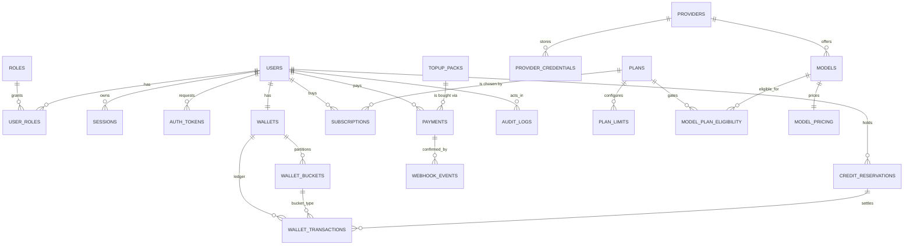

# NEXORA AI — Entity-Relationship Diagram (Phase 2)

PostgreSQL schema managed by Drizzle (`src/db/schema.ts` → `drizzle/*.sql`).
Money is integer **paise**; provider prices integer **micro-USD**; credits are
integers. `wallet_transactions` is append-only (DB trigger blocks
UPDATE/DELETE); balances are derived and verified against the ledger.

## Tables

### Auth
- **roles** — `name` PK (`user`, `admin`), description.
- **users** — email (unique, lowercase), name, password_hash (scrypt), status
  (`active`/`suspended`), email_verified_at, TOTP secret as AES-256-GCM
  envelope (`totp_secret_enc`, `totp_iv`, `totp_auth_tag`), totp_enabled,
  deleted_at (soft delete).
- **user_roles** — (user_id, role_name) PK.
- **sessions** — SHA-256 token_hash (unique), expires_at, ip, user_agent.
  Cookie holds the raw opaque token; the DB never sees it.
- **auth_tokens** — type (`email_verify` 24 h / `password_reset` 60 min),
  token_hash (unique), consumed_at (single-use).

### Plans & subscriptions
- **plans** — id (`free|plus|pro|ultra|max`), price_paise_monthly,
  annual_months_charged, monthly_credits, daily_free_credits, highlights
  (jsonb), popular, active, sort_order.
- **plan_limits** — (plan_id, key) → jsonb value (max_output_tokens,
  requests_per_day, concurrency, file_upload_mb, context_tokens).
- **subscriptions** — user, plan, status (`active|past_due|canceled|expired`),
  billing_cycle, current_period_start/end, cancel_at_period_end, source
  (`manual` until Razorpay, Phase 7), metadata.

### Wallet (spec §6)
- **wallets** — one per user (unique user_id).
- **wallet_buckets** — type (`daily_free|promotional|subscription|purchased`),
  credits, expires_at (null = never), source_ref (subscription/payment),
  indexed for consumption-order scans.
- **wallet_transactions** — **append-only ledger**: signed amount,
  balance_after, bucket_type, reservation_id, reference (idempotency),
  metadata. Invariant: `SUM(amount) == SUM(bucket.credits)`; verified by
  `lib/wallet.verifyLedger`. Corrections are new `adjustment` rows.
- **credit_reservations** — estimated_credits, actual_credits, status
  (`held|committed|released|expired`), **unique idempotency_key**, breakdown
  (per-bucket debit snapshot for exact refunds), expires_at (TTL), settled_at.

### Model registry (Phase 3 consumes; seeded now)
- **providers** — slug, name, adapter (`anthropic|openai|gemini|openai-compatible`),
  base_url, enabled (false until credentials exist).
- **provider_credentials** — AES-256-GCM envelope columns per provider.
- **models** — slug (unique), provider, category, status, capabilities (jsonb),
  context_window, max_output, markup_pct, min_plan_id, last_verified_at,
  source_url, notes, active (unverified seeds ship inactive).
- **model_pricing** — input/output/cached/reasoning in micro-USD per 1M tokens.
- **model_plan_eligibility** — (model_id, plan_id) which plans may call.

### Commerce foundation (Phase 7 consumes)
- **topup_packs** — price_paise, credits, bonus_credits, active, sort_order.
- **payments** — kind (`subscription|topup`), provider (`manual` until
  Razorpay), status (`created|paid|failed|refunded`), amount_paise, currency.
- **webhook_events** — unique (provider, event_id) for idempotent intake.

### Platform
- **settings** — key → jsonb value + description (admin-editable keys are
  whitelisted in `lib/settings-defaults.ts`).
- **audit_logs** — actor_user_id, action, entity_type, entity_id, metadata,
  ip, created_at. Written by every sensitive action (spec §15/§16).
